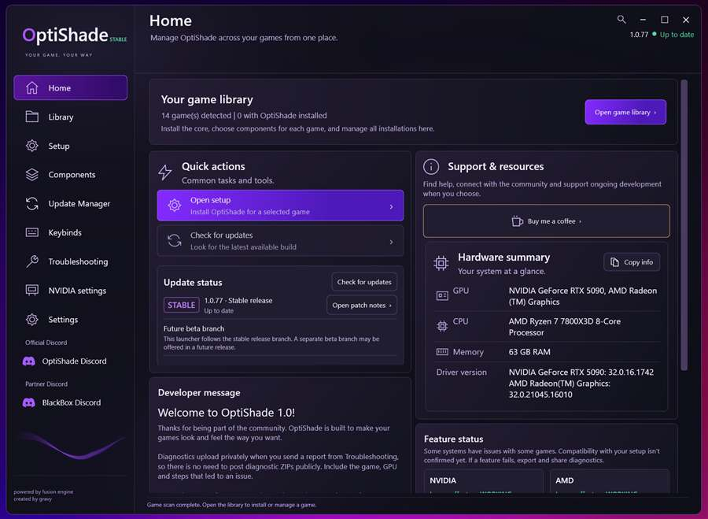
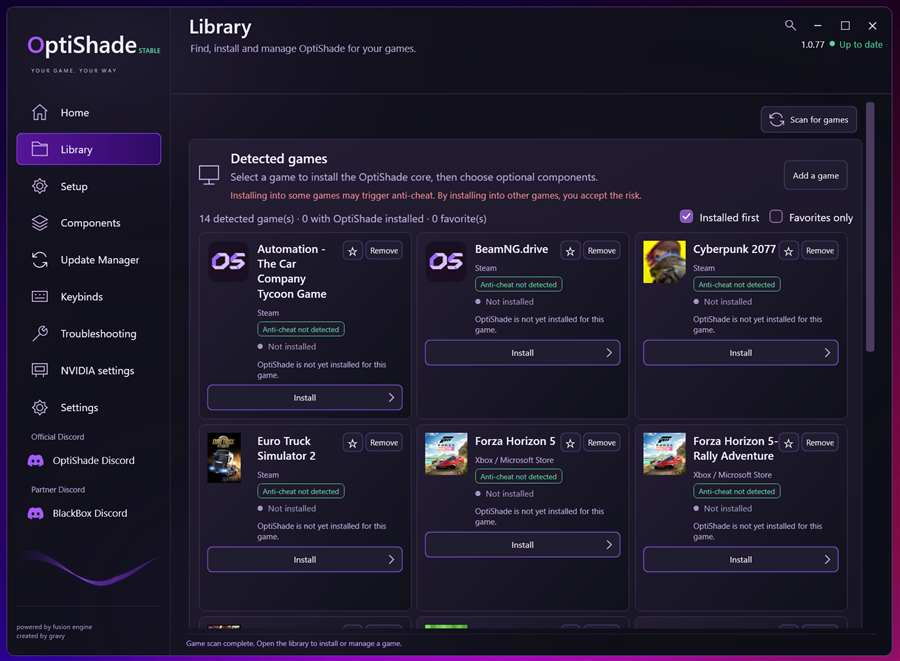
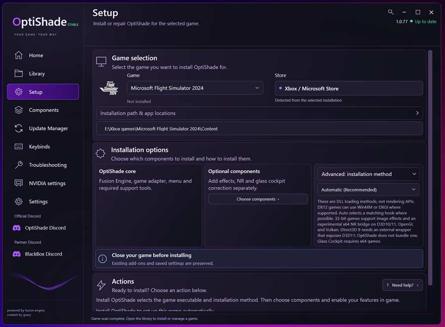
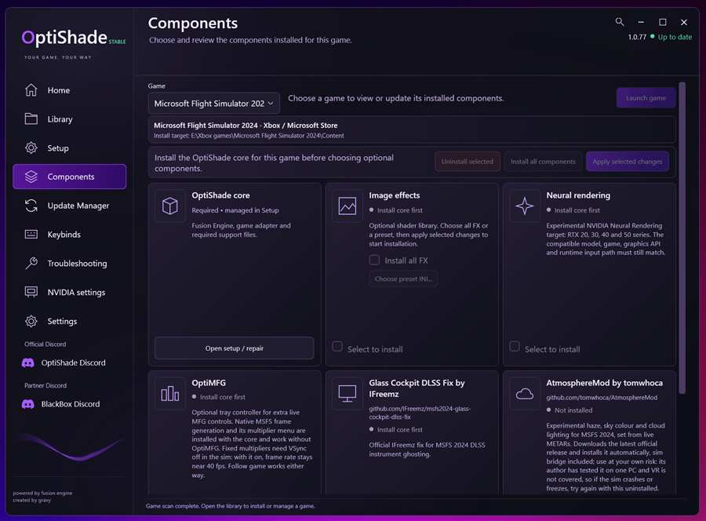
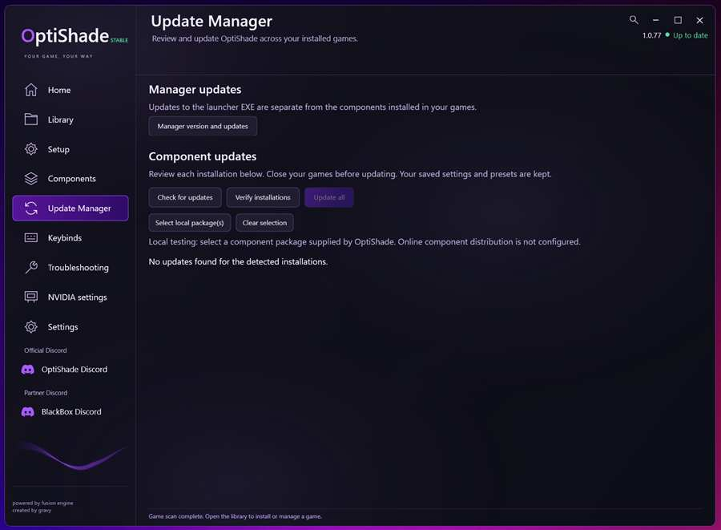
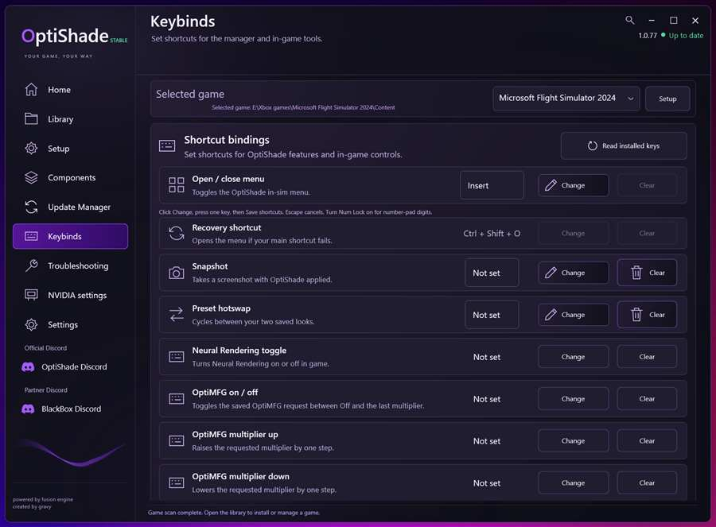
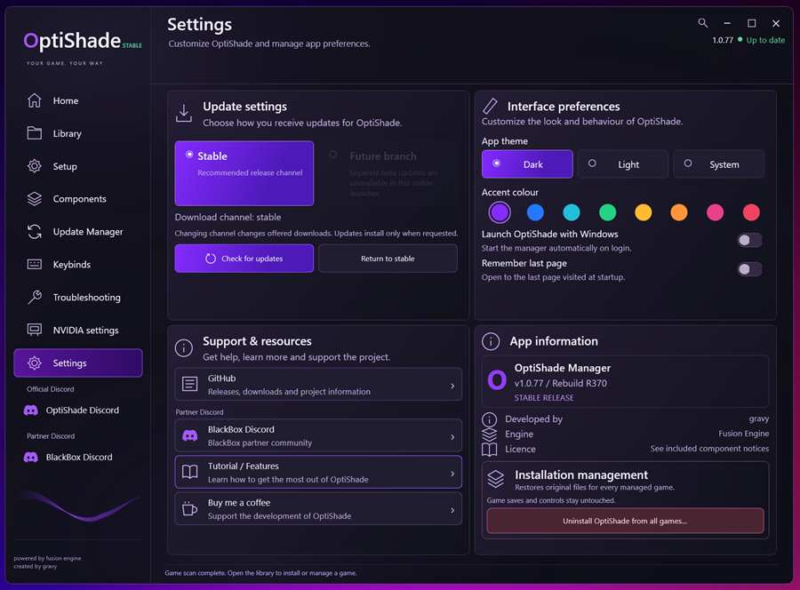

# Welcome to OptiShade 1.0

**Your game, your way.** OptiShade brings game discovery, per-game installation, rendering components, in-game controls and diagnostics together in one Windows app.

## What’s new in 1.0

- **Game library and per-game setup.** Scan or add games, choose an installation method where supported, and select optional components for each game. OptiShade records managed files and keeps backups so repair and uninstall can restore the original files.
- **Anti-cheat checks and warnings.** OptiShade checks known game protection indicators and shows a warning before installation where protection is detected or uncertain. Detection cannot guarantee a game's rules or predict every anti-cheat response. Installing into a protected game is the user's choice and risk.
- **Component management.** The Update Manager separates manager updates from installed game components. Core, OptiMFG and Image Effects each have an independent stable 1.0.77 download branch with SHA-256 manifests. Remote component installation and rollback are not yet enabled, so these packages are marked download-only.
- **OptiMFG.** Optional live frame-generation controls for supported Microsoft Flight Simulator 2020/2024 installations. The game must provide a compatible DLSS Frame Generation / Streamline path. Results depend on the game, GPU, driver and active provider; a listed multiplier is not proof that generated frames are being presented.
- **Image Effects and Look Editor.** Manage shader effects and presets separately from the game's upscaler and frame-generation settings.
- **Neural Rendering controls and diagnostics.** OptiShade can configure supported Neural Rendering paths and reports whether supported inputs and output are observed. A setting being enabled or a model being installed does not itself prove that rendering is active.
- **Glass Cockpit support.** OptiShade can install and manage IFreemz's Glass Cockpit DLSS Fix for Microsoft Flight Simulator 2024. The add-on is credited to IFreemz and retains its upstream licence and notices.
- **AtmosphereMod support.** OptiShade can install the official AtmosphereMod release by tomwhoca after the user selects it. It downloads from the author's release; OptiShade does not redistribute the mod.
- **Troubleshooting and diagnostics.** Collect game, OptiMFG, launcher and installer logs. Suspected hang reports can include bounded log and thread evidence. Full crash dumps contain process memory and are not silently attached to automatic reports; review and select them explicitly.
- **In-game controls and monitoring.** Open the OptiShade interface, configure supported controls and view available runtime status without leaving the game.
- **NVIDIA settings page.** Review and save supported per-game driver profile options before launching. Driver availability and behavior can vary; saved values do not prove a runtime feature loaded.

## How component updates are intended to work

The public GitHub Releases page is reserved for the small installer when it is ready. The installer downloads and verifies the launcher. The launcher checks separate first-party channels for Core, OptiMFG and Image Effects, then downloads only the component selected for update. Neural Rendering continues to use its pinned NVIDIA/model source. Glass Cockpit and AtmosphereMod continue to use their authors' official sources. Package signatures, hashes, compatibility rules, backups and rollback are required before a channel is considered ready.

The component branches contain their versioned packages, inventories, hashes and applicable source or licence notices. Packages are not yet installable through the launcher. This repository does not include the launcher or installer EXE.

## Screenshots

| Library | Per-game setup | Components |
| --- | --- | --- |
|  |  |  |

| Update Manager | In-game controls | Troubleshooting |
| --- | --- | --- |
|  |  |  |

More views: [NVIDIA settings](assets/screenshots/nvidia-settings.jpg) · [Settings](assets/screenshots/settings.jpg).

## Known limits

- Compatibility varies by game, graphics API, GPU, driver and installed rendering provider. OptiShade does not guarantee support for every game or anti-cheat configuration.
- OptiMFG is currently intended for supported MSFS 2020/2024 setups. X-Plane 12 OptiMFG is not included in this release.
- Neural Rendering depends on the game's supported frame inputs and model/runtime compatibility. It may remain inactive even when enabled in OptiShade.
- Game updates, third-party mods, antivirus and permission restrictions can change installation or runtime behavior. Send diagnostics through OptiShade Troubleshooting when reporting a problem.
- Online component delivery is not yet enabled in the launcher. Do not use private build artifacts as release packages.

## Credits and licensing

OptiShade and the original Fusion Engine integration are by **gravy / GamingWithGravy**. OptiShade includes work with distinct licences; each component keeps its own terms and notices.

- **OptiScaler** and its covered OptiShade runtime modifications: GNU GPL v3, including corresponding-source obligations for distributed binaries.
- **ReShade**: BSD 3-Clause; ReShade-derived code and effects keep their applicable attribution and licence notices.
- **RTXMFG backend**: upstream work by **Michael Robles / dashdogy**, distributed unchanged under its MIT licence, with third-party notices preserved. OptiShade's own controller and integration are separate work.
- **Glass Cockpit DLSS Fix**: **IFreemz**; GPL-3.0-only with the project's required attribution and notices. [Official project](https://github.com/IFreemz/msfs2024-glass-cockpit-dlss-fix).
- **AtmosphereMod**: **tomwhoca**. OptiShade downloads the official release after the user selects it; the mod is not redistributed here. [Official project](https://github.com/tomwhoca/AtmosphereMod).
- NVIDIA, AMD, Intel/XeSS, shader authors, SDK maintainers and other contributors retain their respective rights and terms. See [CREDITS.md](CREDITS.md) and the notices distributed with each component.

## Legacy downloads

Older OptiShade 0.x versions are listed in the [legacy branch](https://github.com/GamingWithGravy/OptiShade/tree/legacy) and available from the [Legacy 0.x release](https://github.com/GamingWithGravy/OptiShade/releases/tag/legacy-0.x). Each file has a SHA-256 entry in the catalog.

## Get support

- [OptiShade Discord](https://discord.gg/sq384cjC4N)
- [BlackBox partner Discord](https://discord.gg/aWHUGeCqkz)
- [OptiShade repository](https://github.com/GamingWithGravy/OptiShade)

When reporting an issue, include the game, GPU, graphics API, component versions and the steps that led to it. Use the built-in diagnostics tool to send the relevant logs privately.
